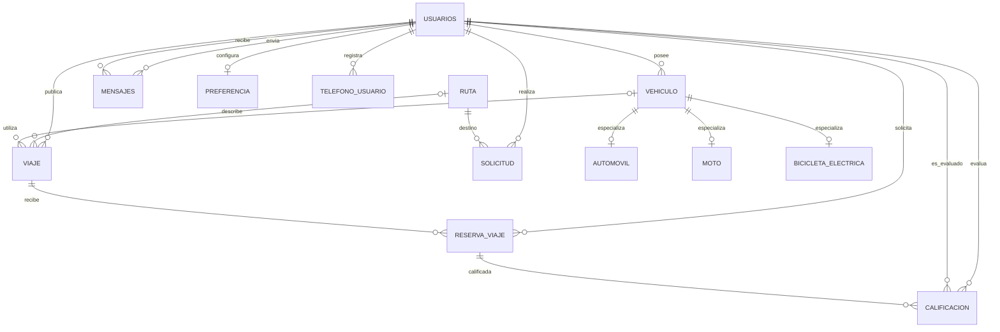

---
tags:
  - base-de-datos
  - cozymov
---

# Base de datos de Cozymov

Bóveda de documentación y navegación del esquema relacional implementado en
`Backend`. Abre el lienzo para explorar las tablas y sus claves foráneas:

![[Grafo relacional.canvas]]

## Diagrama entidad-relación

> [!note] Cardinalidad de las columnas opcionales
> `viaje.id_ruta` y `viaje.id_vehiculo` aceptan `NULL`. Un viaje puede no tener
> una ruta o vehículo asociado; si el vehículo se elimina, el viaje se conserva
> y la referencia queda en `NULL`.

## Tablas

- [[Usuarios]]
- [[Viaje]]
- [[Reserva de viaje]]
- [[Ruta]]
- [[Mensajes]]
- [[Calificacion]]
- [[Preferencia]]
- [[Solicitud]]
- [[Telefono usuario]]
- [[Vehiculo]]
- [[Automovil]]
- [[Moto]]
- [[Bicicleta electrica]]

## Conexiones principales

- [[Usuarios]] publica [[Viaje]], registra [[Vehiculo]], reserva viajes y
  participa en [[Mensajes]] como emisor y receptor. También configura
  [[Preferencia]], registra [[Telefono usuario]], crea [[Solicitud]] y puede
  evaluar o recibir una [[Calificacion]].
- [[Viaje]] puede tener [[Ruta]] y [[Vehiculo]] asociados, y recibe
  [[Reserva de viaje|reservas]].
- [[Reserva de viaje]] puede tener [[Calificacion|calificaciones]]; cada
  [[Solicitud]] apunta a una [[Ruta]].
- [[Vehiculo]] tiene un detalle relacionado en [[Automovil]], [[Moto]] o
  [[Bicicleta electrica]].

Las notas describen las tablas y relaciones según las entidades y
configuraciones de Entity Framework Core. Las claves `IdConductor` de viaje y
los orígenes/destinos de texto no son claves foráneas.

> [!info] Modelo y base desplegada
> Este grafo documenta el modelo y las migraciones del proyecto; no confirma
> que todas las migraciones ya se hayan aplicado a la base de datos configurada.
